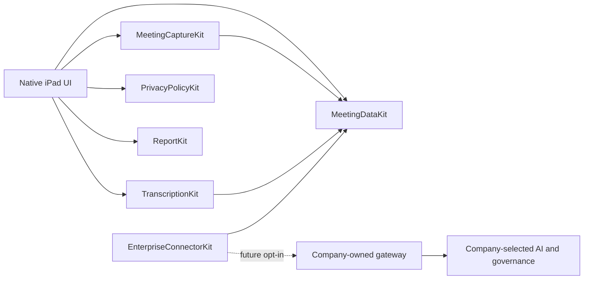

# Architecture

The app composes native modules; public interoperability is defined by JSON Schema/OpenAPI, not Swift or a shared speech library. Android can implement the same contracts independently.

The MVP does not instantiate a production connector. The app has no URLSession client, embedded endpoint, analytics SDK or provider credential. Offline recording is independent of speech support and enterprise availability.

## Capture and persistence

Application Support/OpenPharmaMeeting contains UUID-named metadata and per-meeting audio directories. Write the manifest before opening a new random-named CAF file. Finalize approximately every 60 seconds; record actual decoded duration and SHA-256. Pausing finalizes the current chunk; resuming starts another. Sequential recorder rotation can lose samples at boundaries; gap duration must be measured on hardware. This implementation does not promise gapless capture.

PCM is 16 kHz, mono, 16-bit (~115 MB/hour before container overhead). Check a 250 MiB reserve at start and rotation. Sudden disk exhaustion within a chunk still requires delegate error handling. Timer rotation is best effort under OS scheduling and background constraints. Completed chunks remain useful independently of the final chunk. Recovery never claims to reconstruct missing samples; unreadable metadata remains on disk and is reported to the UI.

Backup exclusion is set on the repository root. Active journals and audio use completeUnlessOpen protection; finalized metadata and temporary speech fragments use complete protection. Atomic journal replacements and new chunk opens may fail while locked. In that case recording stops and recovery preserves available data. Reliable locked recording is an outstanding device gate. No secure deletion guarantee is made for flash storage.

SHA-256 detects accidental audio changes; it does not authenticate a maliciously replaced manifest. OS app isolation/Data Protection are the MVP trust boundary. UUID paths and filename validation prevent traversal. Imported meeting data is limited to 100 MiB; only metadata is imported, without implicitly fetching or restoring audio. Imports cannot overwrite an existing meeting ID.

## Transcription

Read completed audio chunks, verify hashes, slice to at most 45 seconds and require on-device Speech for every recognition request. Preserve per-word media timestamps with concatenated chunk offsets; pause wall time and rotation gaps are not represented as recorded media. A per-request 90-second timeout and cancellation complete through one main-actor gate. Prior transcripts are replaced only after the whole operation succeeds. Temporary speech files are deleted on ordinary completion/failure; process termination may leave protected temporary files until cleanup. Never use remote Speech as fallback.

Availability depends on OS, locale and installed assets. This app does not download a third-party model. A13/A14 performance and long-recording behavior remain unverified.

## Protocol and enterprise boundary

See docs/PLATFORM_CONTRACTS.md and protocol/0.1. Schema validation tools cover structural constraints; MeetingCodec adds native semantic checks (references, ordering, finite times and safe filenames). It is not a general JSON Schema interpreter. Independent protocol fixture tests protect the public contract; adding a generated/runtime validator is a future option.

Private/Restricted/Organization are separate for audio/transcript/reports. Local checks cannot enforce authorization on a remote server or retract exported data. The backend validates tenant identity, resource ownership, policy revisions and action permissions at every API call and again before processing. Enterprise policy controls whether any submission is approved. Corporate models and regulatory workflows never run implicitly on the device.

Optional business logic can later use Kotlin Multiplatform if a measured need emerges. Native capture/speech/credential adapters remain native. Neither platform's speech engine is mandated for the other.
